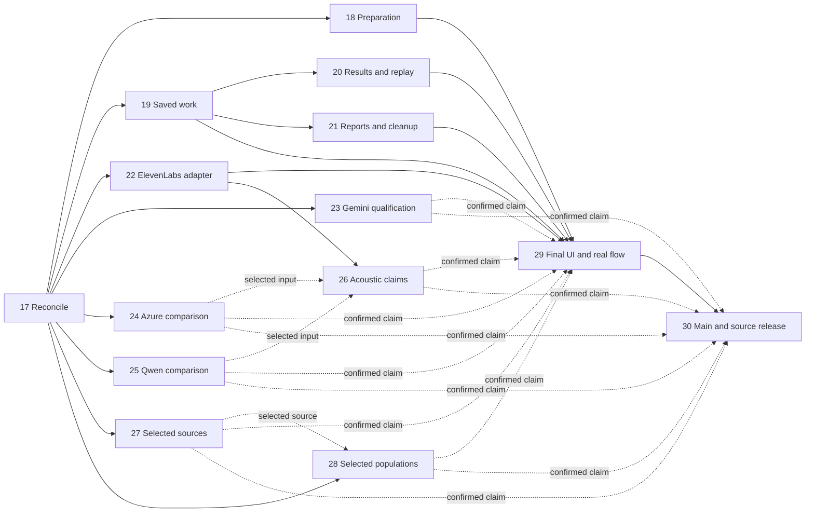

# Remaining-work iterations, 2026-10-25

This continues iterations 1–16. The baseline is release branch revision
`bd5bc18f2d4fb523f44aa73d2e2aad9a630053a0`. It converts the unapplied inventory
into implementation and qualification work; it does not reclassify the 101
older unchecked rows as 101 absent features. `tasks.md` remains the sole task
checklist. `completion-iterations.json` owns routing, dependency edges and exact
verification-property selectors, not a second completion status.

`completion-coverage.md` maps every item in both supplied reports to its
requirement, iteration and proof. Detailed history/replay/guided-form/speech
contracts are in `specification/v2/docs/completion-contract-details.md`.
The baseline listed eight UX findings and the production adapter gap as planned.
I17 now reconciles actual FX work at `8bbc1e2`: all 38 UI case contracts map to 24
reusable and 14 partial observations. Production ElevenLabs integration remains
required; iterations 18–21 retain their own acceptance and residual cases.

New concurrent `functional-category-ux` work is also present. Iteration 17 must
reconcile its actual implementation/receipts before applying overlapping UI
repairs in 18–21. Reuse valid work that meets these contracts; this review does
not silently register, certify or overwrite the other task’s delta.

The user's budget amendment excludes LLM performance benchmarks from completion:
no load/throughput/latency/cost campaigns, model/parameter sweeps, repeated judge
campaigns or bulk 732-case model run. Keep directly relevant functional tests,
reuse valid receipts and deterministic fixtures, and use only necessary
authorized functional calls within actual remaining included/free/local limits.
Saved diagnostic data may be inspected without inference. Excluded campaigns
are out of scope rather than missing prerequisites; no performance pass is claimed.

| Iteration | Scope and required outcome | Depends on |
|---|---|---|
| 17 | Reconcile all 101 baseline unchecked entries, old I4/I5 provider blockers, the I12 report/task mismatch, later I16 acceptance and documented versus installed OpenSpec versions. Every original row receives a referenced disposition. | Existing records |
| 18 | Preparation: visible effective request at all widths; a short basic path to Generate; optional controls retained; readable amount/severity captions. Closes UX-01, UX-06, UX-07. | 17 |
| 19 | Persisted failure reasons and explicit recovery; recognizable attempts, audio and review records with correct full-ID links. Closes UX-02, UX-03. | 17 |
| 20 | Completed results foreground scores and next practice; saved answer stays accessible; finding intervals have explicit stored-audio replay. Closes UX-04, UX-05. | 19 |
| 21 | Reports/experiments have valid starters and field help; Cleanup selects recognizable saved records, then previews and explicitly applies. Closes UX-08. | 19 |
| 22 | Integrate supported ElevenLabs pronunciation dictionaries through the real speech adapter, target scoping, persistence and resume. Verify actual included/free output and unsupported/quota behavior. Closes SP-01. | 17 |
| 23 | Qualify the existing Gemini text route on the actual unbilled project, with a complete selected exercise and retained native/context/Lab evidence. Resolves GEN.R4 only on observed success. | 17; optional selected route |
| 24 | Finish the saved Azure comparison using an actual F0 key/resource: complete clean/mutated dialogue, SSML and target observations. | 17; actual authorized F0 access |
| 25 | Finish both Qwen dialogue variants on a practical local runtime; preserve actual model/voice inputs and honest timeout/partial states. | 17; usable local runtime |
| 26 | Reconcile/reuse CV-01–CV-06 implementation/evidence and resolve selected mixed/unknown acoustic claims, including linking/weak forms and valid connected-speech variants. No automatic bulk judge retry. | 22; 24/25 only if their output is selected |
| 27 | Obtain/import complete selected Cambridge, Doubao, separate Moodrick/NIR and supplementary releases; reconcile official L2 provenance only if claimed. Preserve actual terms and the ICNALE media prohibition. | 17; source-owner access |
| 28 | Verify empirical report arithmetic, provenance and population coverage using saved records or deterministic fixtures. Retain exact missingness; no new LLM or bulk benchmark calls. | 17; 27 only when using those sources |
| 29 | Review all eleven current routes, affected desktop/mobile/error/recovery behavior and typography; verify and record a real full flow with pictures, video, saved audio and independent scoring expectations. | 18–22 |
| 30 | Land verified work into the intended main checkout, preserve unrelated edits, publish to the actual authorized GitHub destination, and prove the published ZIP downloads and runs locally. | 29; destination/publication authority |

Iterations 29/30 additionally depend on 23–28 only for outputs selected or
advertised as confirmed in that acceptance/release scope. Shipping optional
code is not a claim of live-provider, source-completeness or empirical confirmation.

Iterations 23–28 are selected provider/source/empirical qualifications. They do
not block the ordinary configured local/included flow, and they remain required
before claiming their own complete scopes. None is deleted or silently declared
finished. A full selected-scope release claim includes every qualification it
advertises; an unavailable dependency remains explicitly incomplete. Iteration
22 repairs an existing production adapter promise, rather than merely adding an
optional comparison sample.

Every apply iteration first selects its behavior properties and dependent cases
within the included-limit execution scope above,
materializes the literal positive/negative plans through the real owner, then
implements, observes and repairs within authority. AI changes preserve native
prompt/context/model/output and Lab evidence. Keep code layers and responsibilities
separate. Retain valid prior greens and reconcile affected evidence once the batch
is stable; update the canonical task list and commit the implementation.

When an existing FX/CV or earlier test already proves the literal case, bind and
reuse that test and its valid receipt with its exact proof boundary. Implement
only missing assertions/observations; the future command/module names are routing
placeholders, not a requirement to create duplicate test implementations or rerun
unchanged model calls merely to rename a case.

Every verify iteration loads
`docs/development/UI_UX_TYPOGRAPHY_VERIFICATION.md` through the project review
adapter and selects its `FIN-VERIFY.I<n>` property. UI/UX, typography and evidence
have separate actual dispositions. Mechanical observations support the review;
metadata or screenshot counts cannot certify aesthetics, interaction, acoustic
realization or model quality. Verify-only reports; a request including repair
continues through authorized fixes and invalidated-case revalidation.

This plan does not authorize application implementation, new accounts, installs,
source requests, provider use or publication. No purchased credits or overage is
allowed without explicit personal approval for the individual case. All 122
category/recipe identities, 42 formulas and 11 original full-source scopes stay
intact. Ordinary use keeps the existing single-admission/trusted-storage policy;
no human review or repeat stored-data consistency audit is added.

## Iteration 31 — Historical requirements and exact evidence

The user selected this continuation on 2026-10-27. It reconciles all 1,909
entry-revision planned/blocked literals against actual successor source and
retained observations, registers exact bounded reuse, materializes missing
selected deterministic assertions and leaves genuine unmet original scope open.
It does not implement the separately proposed iterations 32–38.

The complete selector is `--commands completion-i31`; its exact original and
I31-owned case edges, retained native dependencies and scope are in
`audit/iteration-31-reconciliation-20261027/SELECTION.json`. The five owned
properties are TRACE31.P1–TRACE31.P5. New native literals run once; the final
committed-clean reconciliation selection reads their actual unchanged typed
outputs instead of repeating accepted behavior. `tasks.md` is the sole checklist.
UI/UX and product typography have concrete not-applicable reasons because no
runtime or presentation owner changes. Existing source/provider/platform needs
and incomplete earlier acceptance scopes are preserved.

### Iteration 32 — actual simultaneous speech and word masking

ENG-01 / ALL-AUDIT.2 is implemented through the production timed PCM composer,
frozen overlap intent, source/final/key clocks and existing resume/finalizer.
The exact five-property/twenty-case selection is in
[audit/iteration-32-overlap-20261027/SELECTION.json](../../../audit/iteration-32-overlap-20261027/SELECTION.json).
It reconciles199 actual retained native observations with independent literal
waveform/key/scoring/recognition assertions. Canonical completion status and
committed-clean acceptance remain in tasks.md and the iteration acceptance file.
No later optional provider/source qualification is silently closed.

## Iteration 33 — retained diagnostic repair

The user-selected QUAL-04 follow-up repairs saved-audio diagnostic context and
ambiguous fixtures. It reuses I26/connected-speech recordings, physical
measurements and replies; it is not a new provider or bulk judge qualification.
Select I33.P1–I33.P5 from SELECTION.json in the iteration audit. Typed unittest
readers reconcile the complete exact native comparison/context/evidence closure
through NATIVE-COVERAGE.json without repeating observed greens. The original CV
commands, test identities and earlier receipts retain their original scope.
See specification/v2/docs/saved-audio-diagnostics.md and the canonical I33 tasks.
The verify follow-up adds real saved-player failure/recovery, keyboard, desktop
and narrow typography, screenshots and screen-recording inspection. It also
isolates correct-control labels and keeps unrecognized model statuses uncertain.
Unchanged original observations remain reusable; no new judge campaign is needed.

## Iteration 35 — Complete official L2-ARCTIC application import

DATA-07 uses the already-admitted official v5 ZIP, not a new acquisition or a
second corpus integrity audit. The production private storage, native parser,
source projector and application commit/readback run in disposable PostgreSQL
and MinIO. All speakers, original documents/containers/media, native annotation
layers/labels/clocks and provenance remain preserved. The official README
speaker table supplies declared gender/L1 metadata; tier ordinals preserve
repeated/unnamed and mixed interval/point layers. Partial or ambiguous source
metadata stays unknown without a new ordinary-use gate. Actual interruption,
persistent reopen/resume, full population counts and application media/record
readback are required; acquisition or a sample parser result cannot substitute.

The exact I35.P1–I35.P4 selection is
`audit/iteration-35-official-l2-20261027/SELECTION.json`. `tasks.md` remains the
single checklist. No provider calls, installs, source publication or user app
changes are included; there is no web presentation change in this increment.

The subsequent user-selected I35 verify includes actual Sources UI/UX and
screenshot/video evidence. Its active selection is I35.P1–I35.P7 in
`audit/iteration-35-verification-20261027/SELECTION.json` (14cases). Full-release
browser quota overflow is repaired by caching a compact saved-data locator and
restoring through existing reads. Native import code/data remain unchanged;
original native receipts are reused. The prior four-property selection remains
the historical apply boundary, not the complete renewed verify selection.

## Iteration 36 — Native JFLEG written corrections

SUP-04:JFLEG uses the already acquired complete owner archive. Preserve all
29owner members plus its container,1501originals and6004reference positions,
separate spellchecked/tool/experimental views and source terms. Native source
parsing, durable resume/commit/readback, Sources examples, development/test
dataset downloads and local reference-membership evaluation have actual
consumers. No model call, source script execution, new service/migration or
new learner prerequisite is required.

Select I36.P1–I36.P7 (14positive/negative cases) via `--requirements I36`.
Actual native/browser/Lab receipts and known experimental M2 bounds findings
are reconciled in `audit/iteration-36-jfleg-20261027/`. The native evaluation
preserves its input and report, and never calls an outside-reference repair
incorrect. The complete selector and checklist remain in SELECTION.json and
tasks.md. Other SUP-04 supplements and TET-GOLD-1 remain separate.
